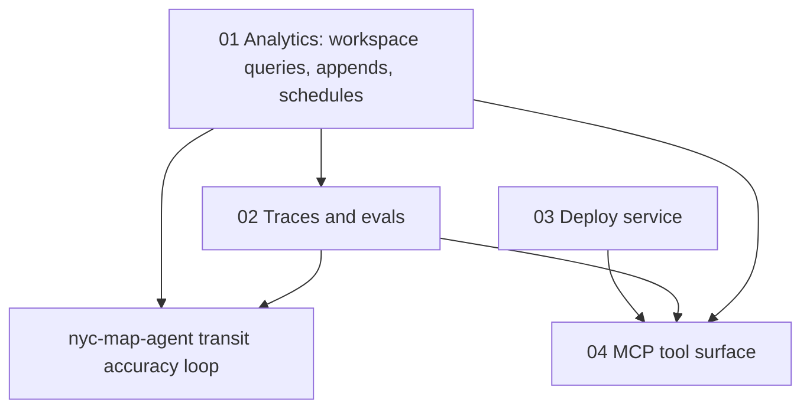

# Issue #340: [ISSUE]: Octo as the project's data layer — analytics, traces/evals, deploy, and a manageable MCP surface (umbrella)

- State: open
- Opened by Pukujan on 2026-10-30
- Original: https://github.com/Pukujan-lab/octo-database/issues/340
- Labels: observational-issue, proposal, account:owner, needs-impact-evidence, needs-record-context, ontology:project-1.0.0, authorization:claimed, filer:human-via-agent, needs-human-verification, priority:5, queue:class-3, queue:class-3:account-01, release:supports, type:observational, status:open, ontology:oio-1.1.0, relation:related, needs-relation-review

Field order and names follow `.github/ISSUE_TEMPLATE/observational-issue.yml`. Shape, lifecycle and relations follow `.oio/ontology/ISSUE_LOG_ONTOLOGY.md`.

### Summary

Octo tells its adopters "Octo is your data layer" (`docs/consuming-octo.md`, title line). A first real adopter question — the nyc-map-agent project wanting its live bus and train position estimates to improve over time — shows four places where that promise runs out:

1. **Analytics** (DuckDB, an in-process analytical database, over Parquet, a columnar file format): a project can only run queries the Octo server already ships, and today there is exactly one. → child #341
2. **Traces and evals** (recording what an agent or app did, and scoring how well it did): no per-workspace home. → child #342
3. **Deploy**: no way for a workspace to ship and run its app through Octo. → child #343
4. **The MCP adapter** (MCP = Model Context Protocol, how agents call Octo's tools): one flat list of 29 tools, set to grow to 60–80 if 2 and 3 land. → child #344

This umbrella records why the four belong together and the order they depend on each other. Each child stands alone and carries its own evidence.

**Proposal** *(proposal — none of this exists yet)*: Octo hosts each shared service once and *manages and routes* to it per workspace (keys, projects, config, history). Octo does not build its own dashboards for these services; it links to the hosted tool's own UI.

Dependency order, in words:

1. Analytics (01) comes first: evals need scored queries, and the transit loop needs rollups.
2. Traces and evals (02) build on 01.
3. Deploy (03) is independent of 01 and 02.
4. The MCP surface (04) must be reshaped before 02 and 03 add their tools, or the flat list roughly doubles.

### Identity and Lineage

- Leaf issue: none (this is the parent of four children).
- Parent: none.
- Children: #341, #342, #343, #344.
- Task/branch: none; drafted on `main` at `d68d959`, no branch, no commit.
- Primary writer: Claude Code side session started from the owner's nyc-map-agent discussion.

### Acceptance Criteria

This umbrella resolves when each child is settled (`resolved`, `wontfix`, `superseded` or `obsolete`) or explicitly parked by the owner (priority path `10`).

- [ ] Owner reviews the overlap with #300, #268 and #13. The children are filed as new logs linked with `related`; they may be folded into those issues instead.
- [ ] Each child is settled or parked.

### Boundaries and Next Action

- Out of scope: any implementation; Octo-built dashboards for traces, evals or deploys; choosing a host machine for shared services (owner decision).
- Next action: owner reviews the priority path and sequencing of the four children.

### Problems vs Gaps

- Problem (evidenced): an adopter cannot register its own dataset shape for analytics (registration requires the `job_failures` columns — child 01, Symptom 2).
- Problem (evidenced): only one query spec exists and none accepts parameters (child 01).
- Gap (untested): wrong-tool choice among similarly named MCP tools — plausible, never observed (child 04).
- Gap (untested): demand for traces/evals and deploy beyond the owner's stated intent and #268 — no adopter has yet been blocked by their absence in a recorded log.

### Issue Type

observational

### Lifecycle Status

open

### Filer Origin (who initiated this filing)

human-via-agent

### Filing Authorization Evidence

claimed

### Session, Authorization Evidence, and Instruction Reference

- Session reference: Claude Code desktop side session, started from parent session `local_01150002-bc7f-4d09-aa88-d9c6d3a01dd5` (nyc-map-agent discussion), 2026-10-29.
- Claimed instruction/source (2026-10-29): owner asked for the analytics gaps, hosted traces/evals, deploy services and the MCP-growth question to be drafted as an Octo issue log in this repository, separate from nyc-map-agent work.
- Authorization evidence: claimed. The owner directed filing on Pukujan/octo-database from the nyc-map-agent session on 2026-10-30 ("Go lets file those issue log", then "Ok" to a message that named the destination). No oio-auth attestation yet.

### Content Author Account or Runtime Identity

agent:claude-code/side-session-of-local_01150002-bc7f-4d09-aa88-d9c6d3a01dd5

### Directing Human GitHub Account ID

137629468 (claimed; matches the owner mapping in `.oio/ontology/project.json`; no oio-auth attestation)

### Destination Repository

Pukujan/octo-database

### Ontology Versions Used

oio=1.1.0; project=1.0.0 (see "Ontology questions": the project file says it extends 1.0.0)

### Project Priority Path

5

### Project Priority Concept ID

pukujan-octo-database:priority-5

### Affected App, Adopter, Users, or Systems

Every adopter that treats Octo as its data layer and needs more than files, a workspace database, retrieval and the one shipped analytics question. First named adopter: nyc-map-agent (live transit map). Also Octo's own MCP adapter and the agents connected to it.

### Observed Consequence and Workaround

Observed: see the children. In short, analytics answers only `job-failures-by-type-month@1`; nothing in `src/` handles traces, evals or deploys; the MCP adapter registers 29 tools in one list.

Interpretation: an adopter that needs any of these must either change octo-db (which `AGENTS.md` forbids adopters to do) or build it in its own project, outside Octo's keys and workspace fence.

Workaround: the adopter's own workspace database plus Octo's raw-SQL route (`query_workspace_database`) covers simple rollups today (child 01, Counter-signal). Traces and deploys have no Octo-side workaround; adopters run their own tools.

### Evidence Confidence

supported

### Impact if Unresolved

low — friction and duplicated per-project infrastructure, no data loss or boundary failure.

### Likelihood

observed (for the analytics limits, in code); plausible (for MCP tool-choice errors)

### Exposure

not-currently-exposed

### Exposure Duration

Not applicable; capability gaps since Slice 7 shipped (locked 2026-10-19).

### Recoverability

documented-recovery

### Recovery Evidence

Nothing is broken. Adopters can work around each gap in their own project (child 01 Counter-signal; #268 notes the same for traces).

### Risk if the Observation Remains Unresolved

Each new adopter re-builds analytics, tracing and deploy plumbing outside Octo, with its own credentials and no workspace binding. The #149 / #162 pattern (adopters designing against capability that isn't there, then bypassing Octo) repeats.

### Risk Introduced by a Proposed Change

Per child. Common thread: every hosted service adds an upstream that must stay fenced per workspace, and every new verb adds MCP tools (child 04).

### Product or Release Relevance

supports

### Named Product Outcome and Cost of Delay

Outcome: "Octo is your data layer" (`docs/consuming-octo.md`) and `PROJECT.md` product success #10 (reuse mature systems rather than rebuild them, as cited in #268). No accepted slice is blocked.

### Cost of Delay

Compounds per adopter rather than per release. The nyc-map-agent accuracy loop is the first concrete cost.

### Smallest Useful Product Slice

Child 01's smallest slice (workspace-registered datasets of any shape plus one parameterised or workspace-defined spec) unblocks the first adopter need. Everything else can follow.

### Provenance and Context

- Destination repository: Pukujan/octo-database
- Source revision: `main` @ `d68d95953f8acfd9f411dfa2980bf7f116d38add`, read 2026-10-29
- Environment: local checkout only; no live instance queried by this session
- Observer: Claude Code side session, directed by owner (claimed)
- Ontology versions: OIO 1.1.0 (installed `default.json`) / project 1.0.0

### Reproducibility Steps and Evidence

See each child. Every code claim there cites a file and was checked at the revision above unless marked *(unverified)*.

### Issue Relations

related: #300
related: #268
related: #13
related: #149
related: #14
related: #341
related: #342
related: #343
related: #344
related: Pukujan/nyc-map-agent#594

(The four children are linked above as `related:`. The ontology has no parent/child relation type; parentage is recorded in Identity and Lineage.)

### Citations and References

- `docs/consuming-octo.md` — "Octo is your data layer"
- `src/analytics/specs.ts`, `src/analytics/registration.ts`, `src/mcp/server.ts`
- `docs/productization/slices/07-historical-analytics.md` — locked Slice 7 packet
- #300 (MCP catalog growth), #268 (tracing via OTLP to Phoenix), #13 (analytics slice), #149 (no analytics surface, pre-Slice 7), #14 (scale/observability)

### Non-Binding Proposed Next Actions

*(proposal)*

- Owner picks priorities, and whether 02 and 04 should instead be comments on #268 and #300.
- 01 first; 04 before 02/03 add tools.

---

**Pukujan commented, 2026-10-31**

Added child #400: UX analytics. A self-hosted PostHog on the server, provisioned by Octo per workspace and user. It is a sibling of #342 (Phoenix for agent traces).
