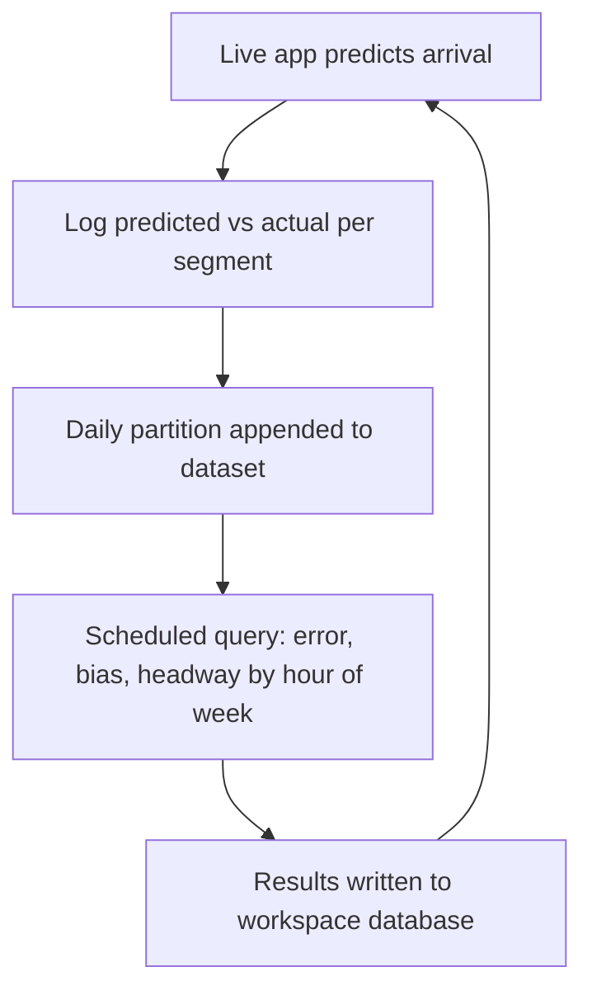

# [ISSUE]: Analytics (DuckDB over Parquet) answers only Octo's own question — a project cannot ask its own

> **DRAFT — not filed.** Child of `00-umbrella.md`. Filing waits for the owner's explicit direction.

## Summary

Octo's analytics layer runs DuckDB (an in-process analytical database) over Parquet (a columnar file format) files kept in R2 (Cloudflare's object store) per workspace. It was built for one accepted question — failed jobs by type and month — and it shows: a project can neither register its own data shape nor ask its own question. Any adopter that needs analytics must change octo-db, which adopters are not allowed to do (`AGENTS.md`, "Adopters do not modify this repository").

The first real adopter need is nyc-map-agent's transit **prediction-accuracy loop**: log predicted vs. actual arrival per route segment, roll up error, bias and headway (time between vehicles) by hour of week, and feed corrections back to the live map.

**Proposal** *(proposal — none of this exists yet)*:

1. **Workspace-defined query specs**, validated server-side so they can read only that workspace's own datasets.
2. **Appendable datasets** — add a partition (one day's file) to a dataset instead of re-registering every file as a new version.
3. **Scheduled analytics jobs** that write their results into the workspace's own database, where the app already reads.
4. **Optional TimescaleDB** (a Postgres time-series extension) for workspace databases.

## Identity and Lineage

- Leaf issue: this draft (unfiled).
- Parent: `00-umbrella.md` (unfiled).
- Task/branch: none; read at `main` @ `d68d959`.
- Primary writer: Claude Code side session.

## Symptoms

1. **Only one query exists.** `src/analytics/specs.ts` defines `QUERY_SPECS` with a single entry, `job-failures-by-type-month@1`. `getQuerySpec` returns `null` for anything else, and the route rejects unknown ids with `400` (`src/routes/analytics.ts:156`). *(verified)*
2. **A dataset must look like a job-failures table to be registered at all.** `src/analytics/registration.ts:30` hard-codes `REQUIRED_SPEC = 'job-failures-by-type-month@1'`, and lines 122–129 reject any schema that does not carry `job_type TEXT, state TEXT, created_at TIMESTAMP` with `400 SCHEMA_MISMATCH`. A transit dataset (`segment_id, predicted_at, actual_at, …`) cannot be registered. *(verified; not in the original brief)*
3. **Specs take no parameters.** `QuerySpec.buildSql(files: string[])` receives only file paths. No date range, route filter or grouping can be passed. *(verified)*
4. **One query reads one immutable version.** `src/analytics/job.ts` header: "One job = one named query over one immutable dataset version." `registration.ts` header: "A re-export is a new version; nothing is mutated." A rolling 60-day window therefore means re-uploading all 60 days as a new version every night. *(verified)*
5. **Results go to a Parquet file, not the workspace database.** `runAnalyticsJob` writes `result.parquet` to the object store and records it via `registerResult` (`src/analytics/job.ts`). Nothing writes results into the workspace's Postgres. *(verified)*
6. **Nothing schedules an analytics query.** `startSchedulers` in `src/server/queue.ts:158` runs only a queue drain (every 60 s) and a retention sweep (hourly). There is no recurring-job definition. *(verified)*
7. **No time-series extension in workspace databases.** Provisioning enables only `vector` (pgvector) (`src/server/provisioning.ts:162`). The database image is `pgvector/pgvector:pg16` (`deploy/local/Dockerfile.db`, `deploy/gravebuster/docker-compose.yml:80`), which is stock Postgres plus pgvector and does not include TimescaleDB. *(verified in code; TimescaleDB absence from the image inferred from the image name, not checked with `pg_available_extensions`.)* A probed workspace reportedly listed only `plpgsql`, `vector`, `btree_gist`, `pg_trgm` *(reported from the nyc-map-agent session; not reproduced here — `btree_gist` and `pg_trgm` are trusted extensions a workspace owner can create itself, so they may have come from the adopter's own migrations)*.

## Why this is by design today

The locked Slice 7 packet (`docs/productization/slices/07-historical-analytics.md`, owner-accepted 2026-10-19) lists **"User-authored SQL"** as out of scope and requires "The caller submits a named spec id; the server builds the SQL." Proposal item 1 therefore needs an owner scope decision, not just code. The packet also notes `PROJECT.md`'s Parquet/DuckDB promise is "only partially delivered".

## The first adopter loop (nyc-map-agent)

In words:

1. The live app predicts when a bus or train reaches each segment.
2. It logs the prediction and the actual arrival.
3. Each day's log is appended to one dataset. *(needs proposal item 2)*
4. A scheduled query rolls up error, bias and headway by segment and hour of week. *(needs items 1 and 3)*
5. Results land in the workspace database. *(needs item 3)*
6. The live app reads those corrections on its next prediction.

Today steps 3–5 fail at Symptom 2 before anything else.

## Hypotheses (unverified)

- **H1** *(hypothesis)*: the one-spec, no-append design is a deliberate first-slice limit, not an architectural barrier; workspace specs can reuse the existing key fencing (`assertWorkspaceKey`) and catalog.
  - Status: open.
  - Would confirm: a workspace-defined spec compiled to `read_parquet([...])` over catalog-derived keys only, passing the existing cross-workspace denial tests.
  - Would refute: DuckDB can reach files outside the passed list from caller SQL (e.g. `read_parquet('s3://…')`, `httpfs`), so caller-authored SQL cannot be fenced by key derivation alone.
  - Experiment: run a caller-shaped query containing a second `read_parquet` path in the current engine sandbox and check whether it is blocked (`enable_external_access`, disabled extensions).
- **H2** *(hypothesis)*: the transit loop's rollups are small enough to run in the workspace Postgres with plain SQL, making DuckDB optional for this adopter.
  - Status: open.
  - Would confirm: 60 days of per-segment rows fit and aggregate within the Slice 21 statement timeout.
  - Would refute: row volume makes the rollup exceed the timeout or bloat the workspace database.
  - Experiment: estimate rows/day from nyc-map-agent's feed and run the rollup via `query_workspace_database` on a disposable workspace.

## Counter-signal

A large part of the loop works **today** without changing octo-db: the adopter can create its own tables in its provisioned workspace database and compute rollups with `date_trunc`, window functions and `percentile_cont` through `query_workspace_database` (`src/routes/workspace-query.ts`), scheduled from its own project. What it cannot get from Octo is scheduling, appendable Parquet history, and TimescaleDB-style compression and continuous aggregates. If H2 holds, item 4 and parts of item 1 may be unneeded for this adopter.

## Honest Caveat

- No volume numbers for nyc-map-agent's feed were measured; whether Postgres alone suffices is untested (H2).
- The extension list from the probed workspace was not reproduced.
- Whether the owner wants caller-authored SQL at all is a scope question the locked Slice 7 packet currently answers "no".

## Problems vs Gaps

- Problem (evidenced): Symptoms 1–6, read in code.
- Gap (untested): whether workspace-authored DuckDB SQL can be fenced safely (H1); whether TimescaleDB is needed (H2).

## Acceptance Criteria

- [ ] A workspace can register a Parquet dataset with its own schema (no `job_failures` columns required).
- [ ] A workspace can run at least one query it defines (or a parameterised spec) over only its own datasets; a cross-workspace read is denied (proposed).
- [ ] A day's partition can be added without re-uploading prior days (proposed).
- [ ] A recurring analytics job can write its result rows into the workspace database (proposed).
- [ ] TimescaleDB decision recorded: enabled, optional per workspace, or declined (proposed).

## Boundaries and Next Action

- Out of scope: a BI tool or analytics UI; a distributed query service; Octo's own operational-history exporter (deferred in Slice 7); changing the epistemic ledger.
- Next action: owner decides whether to reopen Slice 7's "no user-authored SQL" boundary, or prefer parameterised server specs.

## Issue Type

observational

## Lifecycle Status

open

## Filer Origin (who initiated this filing)

human-via-agent (claimed; see umbrella)

## Filing Authorization Evidence

claimed

## Session, Authorization Evidence, and Instruction Reference

- Session reference: Claude Code side session of `local_01150002-bc7f-4d09-aa88-d9c6d3a01dd5`, 2026-10-29.
- Claimed instruction/source: owner asked for Octo's analytics gaps, surfaced in the nyc-map-agent session, to be drafted as an Octo issue log.
- Authorization evidence: claimed; drafting only.

## Content Author Account or Runtime Identity

agent:claude-code/side-session-of-local_01150002-bc7f-4d09-aa88-d9c6d3a01dd5

## Directing Human GitHub Account ID

137629468 (claimed)

## Destination Repository

Pukujan/octo-database

## Ontology Versions Used

oio=1.1.0; project=1.0.0

## Project Priority Path

5 (arguably `4`, adopter friction — the platform works for its one question; owner's call)

## Project Priority Concept ID

pukujan-octo-database:priority-5

## Affected App, Adopter, Users, or Systems

Any adopter needing analytics over its own data. Named: nyc-map-agent (transit accuracy loop). Surface: `register_dataset` / `query_dataset` HTTP routes and MCP tools.

## Observed Consequence and Workaround

Observed: an adopter dataset not shaped like job failures is rejected at registration; only one question can be asked; no appends, parameters, schedules or write-back.
Workaround: own tables and rollups in the workspace database via `query_workspace_database`, scheduled by the adopter (see Counter-signal).

## Evidence Confidence

confirmed (code-level limits); uncertain (adopter volume)

## Impact if Unresolved

low

## Likelihood

observed

## Exposure

not-currently-exposed

## Exposure Duration

Since Slice 7 shipped (packet locked 2026-10-19).

## Recoverability

documented-recovery

## Recovery Evidence

Workspace-database workaround above; no data at risk.

## Risk if the Observation Remains Unresolved

Every adopter needing analytics builds it outside Octo or asks for an octo-db change; the "Octo is your data layer" promise reads as more than is shipped (the #149 pattern).

## Risk Introduced by a Proposed Change

Moderate. Caller-authored DuckDB SQL widens what a request can read; fencing must be proven (H1). Appendable datasets change the "immutable version" contract that results and content hashes rely on. Writing results into workspace databases gives the job worker a write path into tenant databases.

## Product or Release Relevance

supports

## Named Product Outcome and Cost of Delay

"Octo is your data layer" (`docs/consuming-octo.md`); Slice 7 / #13. No accepted slice blocked.

## Cost of Delay

nyc-map-agent's accuracy loop waits or is built outside Octo.

## Smallest Useful Product Slice

Drop the hard `REQUIRED_SPEC` check at registration (validate against the spec at query time instead, which `job.ts` already does) and add one parameterised or workspace-defined spec. That alone lets nyc-map-agent register and query its log.

## Provenance and Context

- Destination: Pukujan/octo-database
- Source revision: `main` @ `d68d95953f8acfd9f411dfa2980bf7f116d38add`, 2026-10-29
- Observer: Claude Code side session (code reading only; no live instance)
- Ontology versions: OIO 1.1.0 / project 1.0.0

## Reproducibility Steps and Evidence

1. `src/analytics/specs.ts` — `QUERY_SPECS` has one key.
2. `src/analytics/registration.ts:30,122-129` — registration rejects schemas lacking `job_type`, `state`, `created_at`.
3. `src/analytics/job.ts` — one spec over one version; result written to object store.
4. `src/server/queue.ts:158-173` — only queue drain and retention sweep are scheduled.
5. `src/server/provisioning.ts:162` — only `vector` is enabled; `deploy/local/Dockerfile.db` is `FROM pgvector/pgvector:pg16`.

## Issue Relations

related: #13
related: #149
related: #268

## Citations and References

- `src/analytics/specs.ts`, `src/analytics/registration.ts`, `src/analytics/job.ts`, `src/routes/analytics.ts`
- `src/server/queue.ts`, `src/server/provisioning.ts`, `src/routes/workspace-query.ts`
- `docs/productization/slices/07-historical-analytics.md` (Out of scope; Deferred)

## Non-Binding Proposed Next Actions

*(proposal)*

- Run the H1 experiment before choosing between workspace-authored SQL and parameterised server specs.
- Run H2 with nyc-map-agent's real volumes before taking on TimescaleDB.
- Treat "append a partition" as a new version that references prior parts by key (no re-upload), so the immutable-version contract holds.
