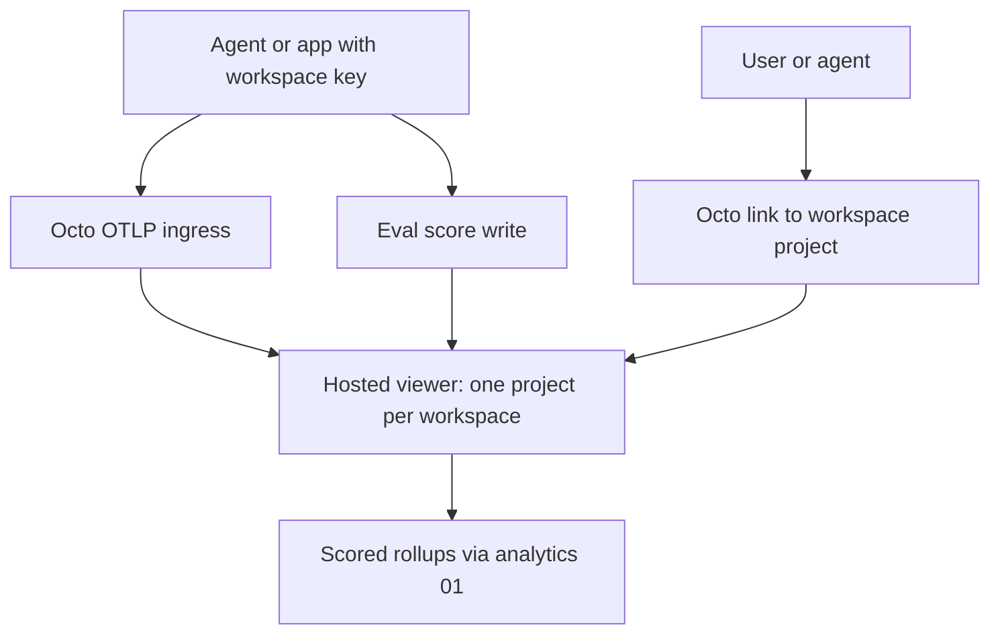

# [ISSUE]: No per-workspace home for traces and eval scores — proposal to host one viewer and let Octo route to it

> **DRAFT — not filed.** Child of `00-umbrella.md`. Overlaps #268 (OTLP ingress to Phoenix); this draft adds eval scores, the host-once/route-per-workspace model, and the analytics dependency. The owner may prefer posting it as a comment on #268.

## Summary

Agents and apps built on Octo have nowhere in Octo to send traces (a record of each step a program or agent took) or eval scores (a number saying how good an output was). Each adopter runs its own tracing tool with its own credentials, outside Octo's keys and workspace fence.

**Proposal** *(proposal — none of this exists yet)*:

1. Accept OpenTelemetry (OTel, the open standard for traces; its wire format is OTLP) per workspace, authenticated with the normal Octo key.
2. Store spans and eval scores fenced per workspace.
3. Host **one** self-hosted viewer once. Octo creates a per-workspace project and key in it and routes users and agents there. **No Octo-built trace dashboard.**
4. Eval queries that need rollups use child 01's analytics.

First natural eval: transit accuracy. "Predicted 8:42, arrived 8:45" is a scored prediction (error +3 min).

In words:

1. The app sends traces to Octo with its workspace key.
2. Octo works out the workspace and forwards to that workspace's project in the hosted viewer.
3. Eval scores attach to traces the same way.
4. Rollups of scores over time run through analytics (child 01).
5. People and agents reach the viewer through a link Octo hands out; Octo builds no viewer of its own.

## Identity and Lineage

- Leaf issue: this draft (unfiled). Parent: `00-umbrella.md`. Branch: none.

## Symptoms

1. No tracing or telemetry code in `src/`: `grep -rniE "otel|otlp|opentelemetry|phoenix|langfuse" src` returns no matches at `d68d959`. *(verified)*
2. #268 (open, 2026-10-17) already proposes an OTLP ingress route to Phoenix with the project derived from the workspace; none of it has landed (Symptom 1).

## Viewer choice (checked 2026-10-29 against vendor docs via web search; re-check before deciding)

- **Phoenix** (Arize, open source): one container; SQLite by default, Postgres 14+ for durable setups (`PHOENIX_SQL_DATABASE_URL`). Could share Octo's existing Postgres cluster in its own database. Lighter.
- **Langfuse** v3 (open source): web + worker containers plus Postgres, ClickHouse (analytics store for traces and scores), Redis/Valkey (queue and cache) and S3-compatible storage (raw events). Heavier: three extra stateful services.
- Leaning: Phoenix, matching #268. *(proposal)*

## Hypotheses (unverified)

- **H1** *(hypothesis)*: Phoenix's project model is enough to fence workspaces if Octo, not the caller, sets the project name and holds the Phoenix key.
  - Status: open.
  - Would confirm: two workspaces' spans land in separate projects and a key for one cannot read the other through the viewer.
  - Would refute: the viewer's own users/keys are instance-wide, so anyone given viewer access sees every workspace's project.
  - Experiment: stand up Phoenix locally, create two projects, check what its access model allows per project.
- **H2** *(hypothesis)*: eval scores can live in the viewer (Phoenix annotations / Langfuse scores) without a second Octo store.
  - Status: open.
  - Would confirm: scores are queryable by project and time range from the viewer's API.
  - Would refute: rollups need a copy in Octo analytics anyway, making the viewer a second source of truth.
  - Experiment: write 1,000 transit scores and query mean error by hour of week through the viewer API.

## Counter-signal

H1 is the weak point: if the viewer has no per-project access control, "route users to it" either exposes all workspaces or needs Octo to proxy the UI — close to building a dashboard, which the owner ruled out.

## Honest Caveat

No adopter log records being blocked by missing traces; demand is the owner's stated direction plus #268. Viewer requirements come from a web search of vendor docs on 2026-10-29, not from running either tool.

## Problems vs Gaps

- Problem (evidenced): no tracing surface in Octo (Symptom 1).
- Gap (untested): per-workspace access in the hosted viewer (H1); score rollups (H2).

## Acceptance Criteria

- [ ] An app with a workspace key can send OTLP traces through Octo and see them in its own project (proposed).
- [ ] A second workspace cannot see them (proposed).
- [ ] An eval score can be attached to a trace and rolled up by time (proposed; depends on 01 or H2).

## Boundaries and Next Action

- Out of scope: an Octo-built trace or eval dashboard; prompt management; metrics/logs beyond traces in the first slice.
- Next action: run the H1 experiment, then fold the outcome into #268.

## Issue Type

observational

## Lifecycle Status

open

## Filer Origin (who initiated this filing)

human-via-agent (claimed; see umbrella)

## Filing Authorization Evidence

claimed

## Session, Authorization Evidence, and Instruction Reference

- Session reference: Claude Code side session of `local_01150002-bc7f-4d09-aa88-d9c6d3a01dd5`, 2026-10-29.
- Claimed instruction/source: owner floated hosted traces/evals managed by Octo (host once, Octo manages and routes, no Octo dashboards) and asked for it to be drafted.
- Authorization evidence: claimed; drafting only.

## Content Author Account or Runtime Identity

agent:claude-code/side-session-of-local_01150002-bc7f-4d09-aa88-d9c6d3a01dd5

## Directing Human GitHub Account ID

137629468 (claimed)

## Destination Repository

Pukujan/octo-database

## Ontology Versions Used

oio=1.1.0; project=1.0.0

## Project Priority Path

5

## Project Priority Concept ID

pukujan-octo-database:priority-5

## Affected App, Adopter, Users, or Systems

Adopters running agents or prediction apps on Octo; first named: nyc-map-agent (transit accuracy as an eval).

## Observed Consequence and Workaround

Observed: no tracing surface. Workaround: each adopter runs its own Phoenix/Langfuse with its own credentials (#268 records the same).

## Evidence Confidence

supported

## Impact if Unresolved

low

## Likelihood

observed

## Exposure

not-currently-exposed

## Exposure Duration

Not applicable.

## Recoverability

documented-recovery

## Recovery Evidence

Adopter-side tracing works today, outside Octo.

## Risk if the Observation Remains Unresolved

Per-project duplication of tracing infrastructure and keys, no workspace binding.

## Risk Introduced by a Proposed Change

Moderate. A new ingress forwards bytes to a new upstream; a misrouted project name leaks one workspace's traces into another. A shared viewer's own login model may not match Octo's workspaces (H1). One more stateful service to back up (#202).

## Product or Release Relevance

supports

## Named Product Outcome and Cost of Delay

`PROJECT.md` product success #10 (reuse mature systems); #268.

## Cost of Delay

Compounds per adopter; none blocked today.

## Smallest Useful Product Slice

#268's slice (OTLP ingress + one Phoenix) plus one eval score type for transit accuracy.

## Provenance and Context

- Destination: Pukujan/octo-database; `main` @ `d68d959`, 2026-10-29
- Observer: Claude Code side session; code reading and vendor-doc web search
- Ontology versions: OIO 1.1.0 / project 1.0.0

## Reproducibility Steps and Evidence

1. `grep -rniE "otel|otlp|opentelemetry|phoenix|langfuse" src` → no tracing code.
2. `gh issue view 268 --repo Pukujan/octo-database` → open proposal, unimplemented.

## Issue Relations

related: #268
related: #14

## Citations and References

- #268 (tracing capability, OTLP to Phoenix)
- Phoenix self-hosting docs: https://arize.com/docs/phoenix/self-hosting/deployment-options
- Langfuse v2→v3 upgrade guide (component list): https://langfuse.com/self-hosting/upgrade/upgrade-guides/upgrade-v2-to-v3.md

## Non-Binding Proposed Next Actions

*(proposal)*

- Settle H1 before committing to "route users to the viewer".
- Keep spans and scores in the viewer; copy into Octo analytics only if H2 refutes.
