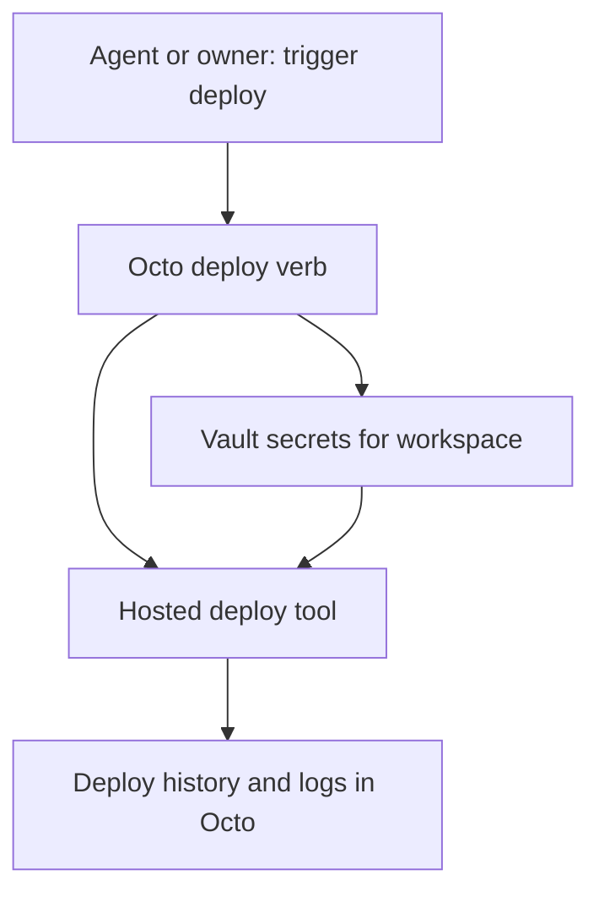

# [ISSUE]: Workspaces cannot deploy or run their app through Octo — proposal to wrap one self-hosted deploy tool

> **DRAFT — not filed.** Child of `00-umbrella.md`. Filing waits for the owner's explicit direction.

## Summary

Octo gives a project its database, files, credentials, analytics and retrieval, but not a place to run the app itself. Each adopter deploys somewhere else (Railway, Vercel, a hand-run server), wiring Octo credentials in by hand.

**Proposal** *(proposal — none of this exists yet)*: Railway/Vercel-style deploys by **wrapping an existing self-hosted tool** — Coolify, Dokku or Kamal — hosted once. Octo owns, per workspace:

- the deploy config;
- vault secrets fed into the app at deploy time (from Octo's existing vault);
- deploy history and logs.

Octo exposes a few verbs — **status, trigger, rollback, logs** — and links to the tool's own UI. No Octo-built deploy dashboard.

In words:

1. An agent or the owner calls `trigger` for a workspace.
2. Octo reads the workspace's deploy config and its vault secrets.
3. Octo hands both to the hosted deploy tool, which builds and runs the app.
4. Octo records the deploy and its logs against the workspace; `status`, `rollback` and `logs` read from there.

## Identity and Lineage

- Leaf issue: this draft (unfiled). Parent: `00-umbrella.md`. Branch: none.

## Symptoms

1. No deploy code in `src/`; no reference to Coolify, Dokku or Kamal anywhere in the repo except a planning transcript (`planning/source/chatgpt-storage-platform-transcript-v1.md`). *(verified by grep at `d68d959`)*
2. #268's smallest slice explicitly excluded "application runtime, and deployment pipeline" — so no open issue owns this. *(verified)*
3. Octo already has a vault and vault relay (`src/routes/vault.ts`, `src/routes/vault-relay.ts`) that a deploy step could read from. *(files exist; how secrets would be delivered to a deploy tool is not designed)*

## Open question for the owner

**Which host runs the deploy tool?** Octo itself runs from `deploy/gravebuster/` (see also #187); whether adopter apps should build and run on that same host or a separate one is the owner's call. Coolify and Dokku expect a Linux host with Docker; Kamal deploys over SSH to any Docker host. This choice decides the tool.

## Hypotheses (unverified)

- **H1** *(hypothesis)*: one of the three tools has an API complete enough for Octo's four verbs without screen-scraping.
  - Status: open.
  - Would confirm: documented API calls for create-app, set-env, deploy, rollback, and fetch logs.
  - Would refute: rollback or logs are UI-only or CLI-only.
  - Experiment: read each tool's API reference; for Kamal (CLI-only), check whether shelling out from the job worker is acceptable to the owner.
- **H2** *(hypothesis)*: Octo's vault can feed secrets to the tool at deploy time without the tool storing them permanently.
  - Status: open.
  - Would confirm: the tool accepts env at deploy time per release.
  - Would refute: the tool only keeps env in its own store, so secrets live in two places.
  - Experiment: check each tool's env handling.

## Counter-signal

No adopter log records being blocked by the lack of deploys; adopters ship today elsewhere. Wrapping a deploy tool adds the most moving parts of the four children (a new host role, build workloads, networking).

## Honest Caveat

Tool capabilities are stated from general knowledge, not checked against current docs in this session. Demand rests on the owner's stated direction.

## Problems vs Gaps

- Problem (evidenced): no deploy surface (Symptom 1).
- Gap (untested): tool API fit (H1), secret hand-off (H2), host choice.

## Acceptance Criteria

- [ ] Owner picks host and tool (proposed).
- [ ] `trigger`, `status`, `rollback`, `logs` work for one workspace's app, with secrets from Octo's vault (proposed).
- [ ] Deploy history is listed per workspace (proposed).

## Boundaries and Next Action

- Out of scope: building a PaaS; an Octo deploy dashboard; multi-host scheduling; mirroring the tool's full API.
- Next action: owner answers the host question.

## Issue Type

observational

## Lifecycle Status

open

## Filer Origin (who initiated this filing)

human-via-agent (claimed; see umbrella)

## Filing Authorization Evidence

claimed

## Session, Authorization Evidence, and Instruction Reference

- Session reference: Claude Code side session of `local_01150002-bc7f-4d09-aa88-d9c6d3a01dd5`, 2026-10-29.
- Claimed instruction/source: owner floated deploy services managed by Octo (host once, Octo manages and routes) and asked for it to be drafted.
- Authorization evidence: claimed; drafting only.

## Content Author Account or Runtime Identity

agent:claude-code/side-session-of-local_01150002-bc7f-4d09-aa88-d9c6d3a01dd5

## Directing Human GitHub Account ID

137629468 (claimed)

## Destination Repository

Pukujan/octo-database

## Ontology Versions Used

oio=1.1.0; project=1.0.0

## Project Priority Path

5 (or `10`, parked, until the host question is answered)

## Project Priority Concept ID

pukujan-octo-database:priority-5

## Affected App, Adopter, Users, or Systems

Adopters that want to ship their app next to their Octo workspace.

## Observed Consequence and Workaround

Observed: no deploy surface. Workaround: deploy elsewhere and copy Octo credentials in by hand.

## Evidence Confidence

supported

## Impact if Unresolved

low

## Likelihood

observed

## Exposure

not-currently-exposed

## Exposure Duration

Not applicable.

## Recoverability

documented-recovery

## Recovery Evidence

External hosting works today.

## Risk if the Observation Remains Unresolved

Secrets copied out of Octo's vault into external platforms by hand; deploy history scattered.

## Risk Introduced by a Proposed Change

High relative to the other children: a build/run host executes adopter code, needs network exposure, and becomes another thing to back up and keep patched. Deploy verbs are outward-facing actions (see child 04 on keeping them as named tools).

## Product or Release Relevance

supports

## Named Product Outcome and Cost of Delay

Owner goal (stated in #268): one API lets an agent stand up a workspace's whole production flow.

## Cost of Delay

Unknown; no adopter blocked.

## Smallest Useful Product Slice

`status` and `trigger` for one workspace on one tool, secrets from the vault, history recorded. `rollback` and `logs` next.

## Provenance and Context

- Destination: Pukujan/octo-database; `main` @ `d68d959`, 2026-10-29
- Observer: Claude Code side session (code reading only)
- Ontology versions: OIO 1.1.0 / project 1.0.0

## Reproducibility Steps and Evidence

1. `grep -rniE "coolify|dokku|kamal" . --exclude-dir=node_modules` → only a planning transcript.
2. `ls src/routes` → no deploy route family.

## Issue Relations

related: #268
related: #187

## Citations and References

- `src/routes/vault.ts`, `src/routes/vault-relay.ts`
- #268 (excludes deployment pipeline from its slice)

## Non-Binding Proposed Next Actions

*(proposal)*

- Owner answers the host question; then a one-page tool comparison against H1/H2.
